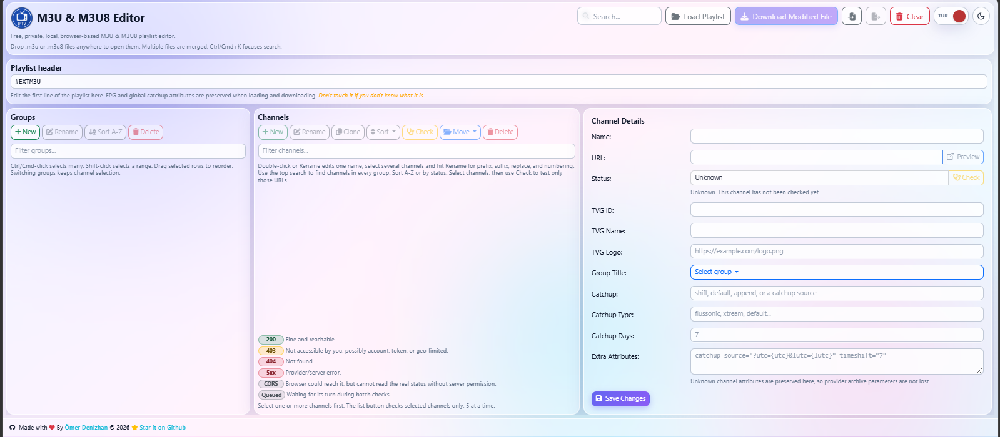
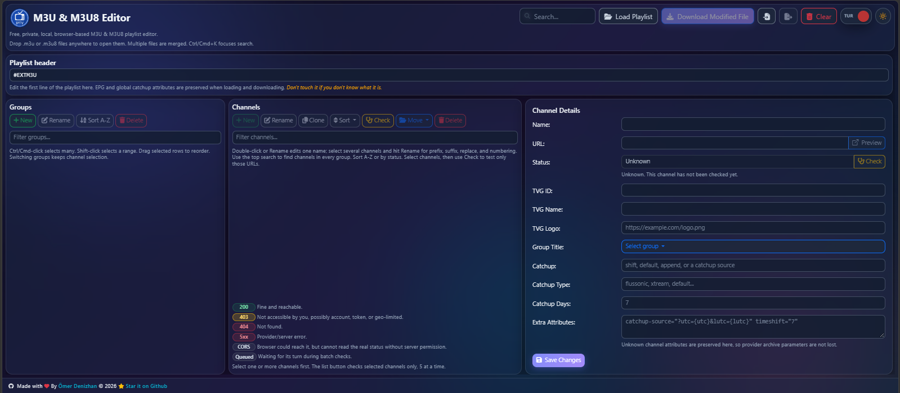

<p align="center"></p>
<h1 align="center">⭐ IPTV M3U & M3U8 Editor ⭐</h1>

A free, private, local, fully browser-based M3U and M3U8 playlist editor. This tool lets you easily manage, edit, and test your IPTV playlists without ever uploading your sensitive data to a third-party server. Everything happens securely inside your browser.

## 📌 Screenshots



## 🚀 Features
* **Complete Privacy:** Files are processed locally in your browser using JavaScript. No data is sent to external servers.
* **File Loading:**
  * Open `.m3u` and `.m3u8` files with the button, or drag and drop them anywhere on the page.
  * When several files are opened at once, they are merged into a single playlist. EPG and catchup header information is merged as well.
  * A progress indicator is shown while loading. Very large files (over 100 MB) ask for confirmation first.
* **Group Management:** 
  * Create, rename, delete, and alphabetically sort groups.
  * Drag and drop groups to reorder them manually.
  * Multi-select groups using `Ctrl/Cmd` or `Shift`.
  * Channel selection is kept when you switch groups, so you can select channels from different groups and process them in one go.
* **Channel Management:**
  * Edit channel details (Name, URL, TVG-ID, TVG-Name, TVG-Logo, Catchup properties). A small preview is shown for the TVG-Logo.
  * Move, clone, or delete channels between groups.
  * Sort channels alphabetically or by HTTP status.
  * Drag and drop to reorder channels.
  * Multi-selection support for bulk actions. If channels are selected in other groups, the counter says so (e.g. "5 selected, 2 in other groups").
  * **Bulk Rename:** Select multiple channels and apply a prefix, suffix, text replacement (with match case and whole word options), and numbering. Changes are previewed before they are applied.
  * **Global Search:** Use the search box at the top (`Ctrl/Cmd + K`) to search channels in all groups by name, URL, TVG information, and group.
  * **URL Preview:** Open a channel's URL in a new tab with one click.
* **Built-in Channel Checker:** 
  * Test channel URLs directly from your browser to see whether they are alive.
  * Checks channels in batches of 5 to avoid network throttling.
  * Detailed status indicators (200 OK, 403 Forbidden, 404 Not Found, CORS limitations, etc.) with an explanation for each status.
* **Preserves Advanced Properties:** Unknown attributes and global playlist headers (such as EPG URLs and catchup settings) are safely preserved when importing and exporting.
* **Project Export/Import:** Export your whole work, including groups, channels, and statuses, as a JSON file and import it later.
* **Automatic Backup:** Before clearing the list, deleting groups, or loading a new playlist or project, a backup of your current work is downloaded automatically.
* **Auto-Save:** Your progress is saved automatically to your browser's Local Storage, so you won't lose your work if you refresh the page by accident.
* **UI/UX Improvements:**
  * **Dark / Light Mode:** Smooth, animated theme transition.
  * **Bilingual:** Built-in English and Turkish language support.
  * Modern, responsive interface powered by Bootstrap 5.
  * Confirmation dialogs for actions such as delete and clear.

## 📌 Sample Playlists
```txt
# Turkey TV Channels
https://raw.githubusercontent.com/omerdenizhan/IPTV-M3U/refs/heads/main/m3u/turkiye.m3u

# Turkey Plus TV Channels
https://raw.githubusercontent.com/omerdenizhan/IPTV-M3U/refs/heads/main/m3u/tv_channels_plus.m3u

# All TV channels grouped by category
https://iptv-org.github.io/iptv/index.category.m3u

# All TV channels grouped by language
https://iptv-org.github.io/iptv/index.language.m3u

# All TV channels grouped by country
https://iptv-org.github.io/iptv/index.country.m3u
```

## 📌 How to Use
1. Open the live demo or run the `index.html` file locally.
2. Select your `.m3u` or `.m3u8` file, or drag and drop it onto the page.
3. Edit groups, channels, URLs, and metadata.
4. Select channels and click the **Check** button to test only those channels.
5. Use **Sort** to order channels from A to Z or by status.
6. When you are done, click **Download Modified File**.

## 🛠️ Usage Instructions
1. **Load a Playlist:** Click the **Load Playlist** button at the top, or drop your `.m3u` or `.m3u8` files onto the page. If you select multiple files, they are merged.
2. **Select Groups:** Click a group in the left panel to view its channels. Selected channels are kept even if you switch groups.
3. **Edit Channels:** 
   * Click a channel in the middle panel to view and edit its details in the right panel.
   * Double-click a channel or group to rename it quickly.
   * Use `Ctrl + Click` (or `Cmd + Click` on Mac) to select multiple channels/groups.
   * Use `Shift + Click` to select a range of channels/groups.
   * Select multiple channels and click **Rename** to rename them in bulk.
4. **Search Channels:** Use the search box at the top (`Ctrl/Cmd + K`) to search across all groups. You can use the channel filter to narrow the results further.
5. **Test Channels:** Select one or more channels and click **Check** to verify whether the streams are online.
6. **Download:** When you are happy with your edits, click **Download Modified File** to save the playlist to your computer.
7. **Move the Project:** Use the **Export** button to save your work as JSON and continue later, and the **Import** button to open it again.
8. **Clear:** Use the **Clear** button to remove the current project from your browser's local storage and start over. A backup is downloaded automatically before deleting.

## 📊 Channel Status Indicator
While using the built-in channel checker, you will see several status badges:
* **200 (Green):** Fine and reachable. The stream is alive.
* **3xx (Yellow):** Redirected. The final URL may still work in a player.
* **403 / 401 (Yellow):** Not accessible by you. It probably requires an account or token, or is geo-blocked.
* **404 / 5xx (Red):** Not found, or a provider/server error. The stream is probably dead.
* **CORS (Gray):** The browser could reach the server, but cannot read the real status without server permission because of Cross-Origin Resource Sharing (CORS) security policies. The stream may still work in a dedicated video player.
* **Blocked (Red):** The browser could not complete the request. It may be mixed content, DNS, network, an ad blocker, or CORS.
* **Queued:** Waiting for its turn during batch checks.

## 💻 Technologies Used
* **HTML5 / CSS3 / Vanilla JavaScript**
* [Bootstrap 5](https://getbootstrap.com/) - For responsive layout and styling.
* [FontAwesome](https://fontawesome.com/) and [Bootstrap Icons](https://icons.getbootstrap.com/) - For interface iconography.
* [SortableJS](https://sortablejs.github.io/Sortable/) - For smooth drag-and-drop reordering.

## 📄 License
This project is released into the public domain under the [Unlicense](https://unlicense.org/); you are free to use, modify, and distribute it as you wish. See the [`LICENSE`](LICENSE) file for details.

## 🕰️ Last Updated
November 17, 2026

---

<p align="center">❤️ Made with Love ❤️</p>

---
