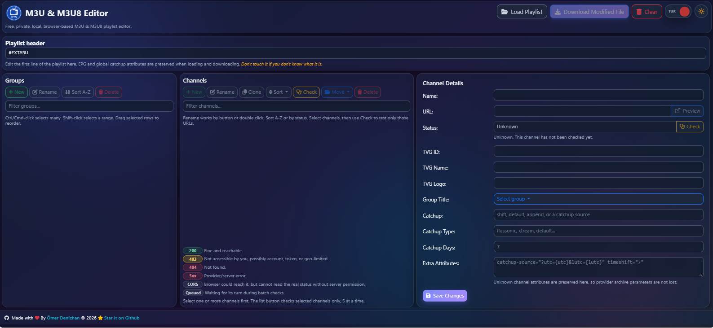
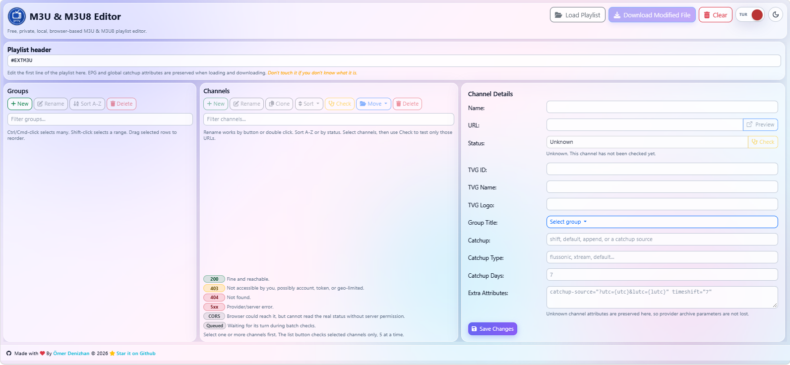

<p align="center"></p>
<h1 align="center">⭐ IPTV M3U & M3U8 Editor ⭐</h1>

A free, private, local, and fully browser-based M3U & M3U8 playlist editor. This tool allows you to easily manage, organize, and test your IPTV playlists without ever uploading your sensitive data to a third-party server. Everything happens securely within your browser.

## 📌 Screenshots



## 🚀 Features
* **Complete Privacy:** Files are processed locally in your browser using JavaScript. No data is sent to external servers.
* **Group Management:** 
  * Create, rename, delete, and sort groups alphabetically.
  * Drag and drop groups to reorder them manually.
  * Multi-select groups using `Ctrl/Cmd` or `Shift`.
* **Channel Management:**
  * Edit channel details (Name, URL, TVG-ID, TVG-Name, TVG-Logo, Catchup attributes).
  * Move channels between groups, clone, or delete them.
  * Sort channels alphabetically or by their HTTP status.
  * Drag and drop to rearrange channels.
  * Multi-select support for batch actions.
* **Built-in Channel Checker:** 
  * Test channel URLs directly from the browser to see if they are active.
  * Checks channels in batches to prevent network throttling.
  * Detailed status indicators (200 OK, 403 Forbidden, 404 Not Found, CORS limitations, etc.).
* **Preserves Advanced Attributes:** Unknown attributes and global playlist headers (like EPG URLs and catchup settings) are safely preserved during import and export.
* **Auto-Save:** Your progress is automatically saved to your browser's Local Storage, so you won't lose your work if you accidentally refresh the page.
* **UI/UX Enhancements:**
  * **Dark / Light Mode:** Smooth, animated theme toggle.
  * **Bilingual:** Built-in English and Turkish language support.
  * Modern, responsive interface powered by Bootstrap 5.

## 📌 Sample Playlists
```txt
# Türkiye TV Channels
https://raw.githubusercontent.com/omerdenizhan/IPTV-M3U/refs/heads/main/m3u/turkiye.m3u

# Türkiye Plus TV Channels
https://raw.githubusercontent.com/omerdenizhan/IPTV-M3U/refs/heads/main/m3u/tv_channels_plus.m3u

# All TV channels grouped by category
https://iptv-org.github.io/iptv/index.category.m3u

# All TV channels grouped by language
https://iptv-org.github.io/iptv/index.language.m3u

# All TV channels grouped by country
https://iptv-org.github.io/iptv/index.country.m3u
```

## 📌 How to Use
1. Open the live demo or run `index.html` locally.
2. Choose your `.m3u` or `.m3u8` file.
3. Edit groups, channels, URLs, and metadata.
4. Select channels and click **Check** to test only those channels.
5. Use **Sort** to sort channels A-Z or by status.
6. Click **Download Modified M3U** when you are done.

## 🛠️ Usage Instructions
1. **Load a Playlist:** Click the file input button at the top to upload your `.m3u` or `.m3u8` file.
2. **Select Groups:** Click on a group in the left panel to view its channels.
3. **Edit Channels:** 
   * Click on a channel in the middle panel to view and edit its details in the right panel.
   * Double-click a channel or group to quickly rename it.
   * Use `Ctrl + Click` (or `Cmd + Click` on Mac) to select multiple channels/groups.
   * Use `Shift + Click` to select a range of channels/groups.
4. **Test Channels:** Select one or more channels and click the **Check** button to verify if the streams are online.
5. **Download:** Once you are happy with your edits, click the **Download Modified M3U & M3U8** button to save the file to your computer.
6. **Clear:** Use the **Clear** button to wipe the current project from your browser's local storage and start fresh.

## 📊 Channel Status Legend
When using the built-in channel checker, you will see various status badges:
* **200 (Green):** Fine and reachable. The stream is active.
* **403 / 401 (Yellow):** Not accessible by you. Possibly requires an account, token, or is geo-blocked.
* **404 / 5xx (Red):** Not found or provider/server error. The stream is likely dead.
* **CORS (Grey):** The browser could reach the server, but cannot read the real status without server permission due to Cross-Origin Resource Sharing security policies. The stream might still work in a dedicated video player.
* **Queued:** Waiting for its turn during batch checks.

## 💻 Technologies Used
* **HTML5 / CSS3 / Vanilla JavaScript**
* [Bootstrap 5](https://getbootstrap.com/) - For responsive layout and styling.
* [FontAwesome](https://fontawesome.com/) & [Bootstrap Icons](https://icons.getbootstrap.com/) - For UI iconography.
* [SortableJS](https://sortablejs.github.io/Sortable/) - For smooth drag-and-drop reordering.

## 📄 License
This project is released into the public domain under the [Unlicense](https://unlicense.org/); you are free to use, modify, and distribute it as you wish. See the [`LICENSE`](LICENSE) file for details.

## 🕰️ Last Update
Oct 21, 2026

---

<p align="center">❤️ Made with Love ❤️</p>

---
