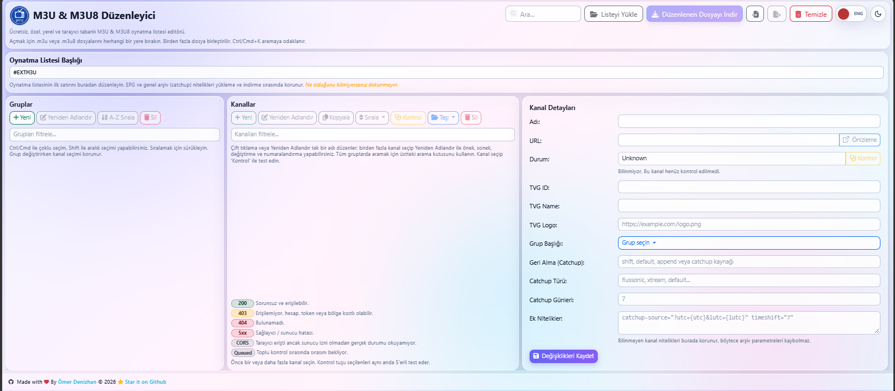
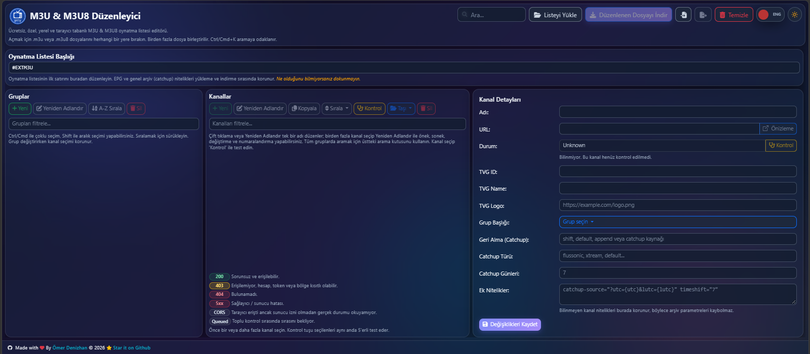

<p align="center"></p>
<h1 align="center">⭐ IPTV M3U ve M3U8 Düzenleyici ⭐</h1>

Ücretsiz, gizli, yerel ve tamamen tarayıcı tabanlı bir M3U ve M3U8 oynatma listesi düzenleyicisi. Bu araç, hassas verilerinizi asla üçüncü taraf bir sunucuya yüklemeden IPTV oynatma listelerinizi kolayca yönetmenize, düzenlemenize ve test etmenize olanak tanır. Her şey tarayıcınızın içinde güvenli bir şekilde gerçekleşir.

## 📌 Ekran Görüntüleri



## 🚀 Özellikler
* **Tam Gizlilik:** Dosyalar, JavaScript kullanılarak tarayıcınızda yerel olarak işlenir. Harici sunuculara hiçbir veri gönderilmez.
* **Dosya Yükleme:**
  * `.m3u` ve `.m3u8` dosyalarını düğmeyle seçebilir veya sayfanın herhangi bir yerine sürükleyip bırakabilirsiniz.
  * Birden fazla dosya aynı anda açılırsa tek bir listede birleştirilir. EPG ve catchup başlık bilgileri de birleştirilir.
  * Yükleme sırasında ilerleme göstergesi bulunur. Çok büyük dosyalarda (100 MB üzeri) önce onay istenir.
* **Grup Yönetimi:** 
  * Grupları oluşturun, yeniden adlandırın, silin ve alfabetik olarak sıralayın.
  * Manuel olarak yeniden sıralamak için grupları sürükleyip bırakın.
  * `Ctrl/Cmd` veya `Shift` kullanarak grupları çoklu seçin.
  * Grup değiştirirken kanal seçimi korunur; farklı gruplardaki kanalları seçip tek seferde işleyebilirsiniz.
* **Kanal Yönetimi:**
  * Kanal ayrıntılarını düzenleyin (Ad, URL, TVG-ID, TVG-Name, TVG-Logo, Catchup özellikleri). TVG-Logo için küçük bir önizleme gösterilir.
  * Kanalları gruplar arasında taşıyın, kopyalayın veya silin.
  * Kanalları alfabetik olarak veya HTTP durumlarına göre sıralayın.
  * Kanalları yeniden düzenlemek için sürükleyip bırakın.
  * Toplu işlemler için çoklu seçim desteği. Başka gruplarda seçili kanallar varsa sayaç bunu belirtir (ör. "5 seçili, 2 diğer gruplarda").
  * **Toplu Yeniden Adlandırma:** Birden fazla kanal seçip önek, sonek, metin değiştirme (büyük/küçük harf ve tam kelime seçenekleriyle) ve numaralandırma uygulayın. Değişiklikler uygulanmadan önce önizlenir.
  * **Genel Arama:** Üstteki arama kutusuyla (`Ctrl/Cmd + K`) tüm gruplardaki kanalları ad, URL, TVG bilgileri ve gruba göre arayın.
  * **URL Önizleme:** Kanalın URL'sini tek tıkla yeni sekmede açın.
* **Yerleşik Kanal Denetleyicisi:** 
  * Aktif olup olmadıklarını görmek için kanal URL'lerini doğrudan tarayıcıdan test edin.
  * Ağ daralmasını (throttling) önlemek için kanalları 5'erli gruplar halinde kontrol eder.
  * Ayrıntılı durum göstergeleri (200 Tamam, 403 Yasak, 404 Bulunamadı, CORS sınırlamaları vb.) ve her durum için açıklama.
* **Gelişmiş Özellikleri Korur:** Bilinmeyen özellikler ve genel oynatma listesi başlıkları (EPG URL'leri ve catchup ayarları gibi) içe ve dışa aktarma sırasında güvenle korunur.
* **Proje Dışa/İçe Aktarma:** Gruplar, kanallar ve durum bilgileriyle tüm çalışmanızı JSON dosyası olarak dışa aktarıp daha sonra içe aktarabilirsiniz.
* **Otomatik Yedek:** Listeyi temizlemeden, grupları silmeden veya yeni bir liste/proje yüklemeden önce mevcut çalışmanızın yedeği otomatik olarak indirilir.
* **Otomatik Kaydetme:** İlerlemeniz tarayıcınızın Yerel Depolamasına (Local Storage) otomatik olarak kaydedilir, böylece sayfayı yanlışlıkla yenilerseniz çalışmanızı kaybetmezsiniz.
* **Arayüz/Kullanıcı Deneyimi (UI/UX) İyileştirmeleri:**
  * **Koyu / Açık Mod:** Pürüzsüz, animasyonlu tema geçişi.
  * **İki Dilli:** Yerleşik İngilizce ve Türkçe dil desteği.
  * Bootstrap 5 ile desteklenen modern, duyarlı arayüz.
  * Silme ve temizleme gibi işlemlerde onay penceresi.

## 📌 Örnek Oynatma Listeleri
```txt
# Türkiye TV Kanalları
https://raw.githubusercontent.com/omerdenizhan/IPTV-M3U/refs/heads/main/m3u/turkiye.m3u

# Türkiye Plus TV Kanalları
https://raw.githubusercontent.com/omerdenizhan/IPTV-M3U/refs/heads/main/m3u/tv_channels_plus.m3u

# Kategoriye göre gruplandırılmış tüm TV kanalları
https://iptv-org.github.io/iptv/index.category.m3u

# Dile göre gruplandırılmış tüm TV kanalları
https://iptv-org.github.io/iptv/index.language.m3u

# Ülkeye göre gruplandırılmış tüm TV kanalları
https://iptv-org.github.io/iptv/index.country.m3u
```

## 📌 Nasıl Kullanılır
1. Canlı demoyu açın veya `index.html` dosyasını yerel olarak çalıştırın.
2. `.m3u` veya `.m3u8` dosyanızı seçin ya da sayfaya sürükleyip bırakın.
3. Grupları, kanalları, URL'leri ve üst verileri (metadata) düzenleyin.
4. Kanalları seçin ve yalnızca o kanalları test etmek için **Check** (Kontrol Et) düğmesine tıklayın.
5. Kanalları A'dan Z'ye veya durumlarına göre sıralamak için **Sort** (Sırala) özelliğini kullanın.
6. İşiniz bittiğinde **Download Modified M3U** (Değiştirilmiş M3U'yu İndir) düğmesine tıklayın.

## 🛠️ Kullanım Talimatları
1. **Oynatma Listesi Yükleyin:** `.m3u` veya `.m3u8` dosyalarınızı yüklemek için üstteki **Liste Yükle** düğmesine tıklayın ya da dosyaları sayfaya bırakın. Birden fazla dosya seçerseniz birleştirilir.
2. **Grupları Seçin:** Kanallarını görüntülemek için sol paneldeki bir gruba tıklayın. Grup değiştirseniz de seçili kanallar korunur.
3. **Kanalları Düzenleyin:** 
   * Ayrıntılarını sağ panelde görüntülemek ve düzenlemek için orta paneldeki bir kanala tıklayın.
   * Hızlıca yeniden adlandırmak için bir kanala veya gruba çift tıklayın.
   * Birden çok kanalı/grubu seçmek için `Ctrl + Tıklama` (veya Mac'te `Cmd + Tıklama`) kullanın.
   * Bir dizi kanalı/grubu seçmek için `Shift + Tıklama` kullanın.
   * Birden çok kanal seçip **Rename** (Yeniden Adlandır) düğmesine tıklayarak toplu yeniden adlandırma yapın.
4. **Kanal Arayın:** Üstteki arama kutusunu (`Ctrl/Cmd + K`) kullanarak tüm gruplarda arama yapın. Sonuçlar içinde ek filtreleme için kanal filtresini kullanabilirsiniz.
5. **Kanalları Test Edin:** Yayınların çevrimiçi olup olmadığını doğrulamak için bir veya daha fazla kanal seçin ve **Check** (Kontrol Et) düğmesine tıklayın.
6. **İndirin:** Düzenlemelerinizden memnun kaldığınızda, dosyayı bilgisayarınıza kaydetmek için **Download Modified M3U & M3U8** (Değiştirilmiş M3U ve M3U8'i İndir) düğmesine tıklayın.
7. **Projeyi Taşıyın:** Çalışmanızı daha sonra devam etmek üzere JSON olarak **Dışa Aktar**, tekrar açmak için **İçe Aktar** düğmelerini kullanın.
8. **Temizle:** Geçerli projeyi tarayıcınızın yerel depolama alanından silmek ve baştan başlamak için **Clear** (Temizle) düğmesini kullanın. Silmeden önce yedek otomatik olarak indirilir.

## 📊 Kanal Durumu Göstergesi
Yerleşik kanal denetleyicisini kullanırken çeşitli durum rozetleri göreceksiniz:
* **200 (Yeşil):** Sorunsuz ve ulaşılabilir. Yayın aktiftir.
* **3xx (Sarı):** Yönlendirme. Son URL bir oynatıcıda yine de çalışabilir.
* **403 / 401 (Sarı):** Sizin tarafınızdan erişilemez. Muhtemelen bir hesap veya jeton (token) gerektirir ya da coğrafi olarak engellenmiştir.
* **404 / 5xx (Kırmızı):** Bulunamadı veya sağlayıcı/sunucu hatası. Yayın muhtemelen ölüdür.
* **CORS (Gri):** Tarayıcı sunucuya ulaşabildi, ancak Çapraz Kökenli Kaynak Paylaşımı (CORS) güvenlik politikaları nedeniyle sunucu izni olmadan gerçek durumu okuyamıyor. Yayın, özel bir video oynatıcıda hala çalışabilir.
* **Blocked (Kırmızı):** Tarayıcı isteği tamamlayamadı. Karışık içerik (mixed content), DNS, ağ, reklam engelleyici veya CORS kaynaklı olabilir.
* **Queued (Kuyrukta):** Toplu kontroller sırasında sırasını bekliyor.

## 💻 Kullanılan Teknolojiler
* **HTML5 / CSS3 / Vanilla JavaScript**
* [Bootstrap 5](https://getbootstrap.com/) - Duyarlı düzen ve stillendirme için.
* [FontAwesome](https://fontawesome.com/) ve [Bootstrap Icons](https://icons.getbootstrap.com/) - Arayüz ikonografisi için.
* [SortableJS](https://sortablejs.github.io/Sortable/) - Pürüzsüz sürükle ve bırak ile yeniden sıralama için.

## 📄 Lisans
Bu proje [Unlicense](https://unlicense.org/) kapsamında kamu malı (public domain) olarak yayınlanmıştır; dilediğiniz gibi kullanmakta, değiştirmekte ve dağıtmakta özgürsünüz. Ayrıntılar için [`LICENSE`](LICENSE) dosyasına bakın.

## 🕰️ Son Güncelleme
17 Kasım 2026

---

<p align="center">❤️ Made with Love ❤️</p>

---
